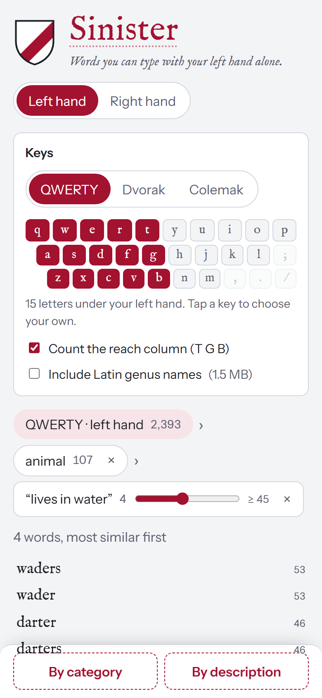

# Sinister

Sinister finds real English words that you can type with one hand, then narrows them with
chained filters. It is built for <https://sinister.mazzaella.com>. In right-hand mode the
site becomes Dexter: *sinister* and *dexter* are Latin for left and right.



The app is static and runs entirely in the browser. Netlify serves the files. The page
address holds the hand, the key set and the filter chain, so a link reproduces a result.

## Use it

1. Choose a hand. Choose QWERTY, Dvorak or Colemak, and decide whether the index finger's
   reach column (T G B / Y H N on QWERTY) counts. To use any key set you like, tap keys on
   the keyboard.
2. Narrow the list. Each filter is a chip showing how many words are left after it.
   Remove any chip to drop that filter.
   - **By category** browses WordNet's hypernym tree (animal › reptile › snake). It is exact.
   - **By description** ranks the remaining words by similarity to free text, such as
     "things in a kitchen". A slider sets the minimum similarity. The first use downloads
     about 32 MB. After that, it runs on the device and works offline.
3. Tap a word to see its meanings.

## Develop

Use [Bun](https://bun.sh) for everything.

```sh
bun install
bun run dev         # Vite dev server
bun test            # unit and property tests
bun run build       # type-check and build to dist/
bun run e2e         # Playwright: offline, Dexter links, screenshots (run build first)
```

| Path | Contents |
|---|---|
| `src/engine/` | Pure TypeScript: layouts and the letter filter (`keys.ts`), the WordNet taxonomy (`lexicon.ts`), and the description filter's text and vector maths (`semantic.ts`) |
| `src/chain.ts`, `src/state.ts` | The filter chain and its URL encoding |
| `src/main.ts`, `src/style.css`, `src/identity.ts` | The UI, and the Sinister and Dexter identities |
| `src/embed.worker.ts` | Web Worker that loads the embedding model the first time it is used |
| `scripts/` | Offline data builds, the evaluation, and image rendering |
| `data/build/` | Generated data the site serves (committed) |
| `spike/`, `e2e/spike.e2e.ts` | The precomputed-versus-on-demand vector spike |
| `docs/adr/` | Design records |

### Rebuild the data

The site never builds data at runtime. Download the sources into `data/raw/` (gitignored),
then run the scripts:

```sh
mkdir -p data/raw/gbif
curl -L -o data/raw/oewn-2025-plus-json.zip https://github.com/globalwordnet/english-wordnet/releases/download/2025-edition/english-wordnet-2025-plus-json.zip
unzip -o data/raw/oewn-2025-plus-json.zip -d data/raw/oewnplus
curl -L -o data/raw/large_en.msgpack.gz https://raw.githubusercontent.com/rspeer/wordfreq/master/wordfreq/data/large_en.msgpack.gz
curl -L -o data/raw/gbif/backbone.zip https://hosted-datasets.gbif.org/datasets/backbone/current/backbone.zip   # 926 MB

bun run data                          # words.json, senses.json, glosses/
bun run data:latin                    # latin.json (needs unzip)
bun scripts/embed-synsets.ts hyper    # about 5 minutes; caches data/raw/vectors-hyper.f32
bun run data:vectors                  # vectors.bin
bun run eval                          # precision table (also embed "gloss" for the full matrix)
```

## Data

| File | Size (brotli) | Loaded |
|---|---|---|
| `words.json` | 401 KB | At startup: 109,519 words, most frequent first |
| `senses.json` | 1.4 MB | First category filter or word lookup: meanings and the hypernym tree |
| `glosses/*.json` | 2.0 MB in 59 shards | One shard at a time, when you open a word |
| `vectors.bin` | 4.2 MB | First description filter: one 384-bit vector per WordNet meaning |
| `latin.json` | 1.5 MB | When you turn on Latin names |

Before the model loads, a visit downloads about 570 KB (brotli): the page, script,
styles, fonts and word list.

**Words.** The list starts from Open English WordNet 2025 Plus. It keeps single-word lemmas
made of a to z, and drops abbreviations, element symbols and Roman numerals. It adds regular
plurals, verb forms and comparatives that wordfreq has seen, plus WordNet's irregular forms.
Words are ranked by wordfreq; words wordfreq lacks follow, shortest first.

**Latin names.** The subset is accepted genera in the GBIF Backbone Taxonomy (2023-08-28)
with at least one accepted species. It leaves out viruses and names WordNet already has:
244,648 genera in total. Genus names are single Latin words, which is what the one-hand
filter matches. Species epithets repeat across genera, and binomials are two words. More
species ranks a genus higher. Each genus is filed under WordNet's matching "X genus"
synset, so the category filter covers it.

## Checks

- **Exactness.** A property test (`tests/keys.test.ts`, fast-check) proves that every listed
  word uses only allowed keys and that no typable word is missing. It covers all
  layouts, both hands, both reach settings, random custom key sets and mirrored sets.
- **Known records.** "stewardesses" and "aftereffects" appear for QWERTY left. "lollipop" and
  "monopoly" appear for QWERTY right.
- **URL state.** Any state survives a round trip through the address (property test).
- **Description filter precision.** For 10 category names, precision@30 is scored against
  the WordNet descendants of each category's synset (`bun run eval`). The shipped setup
  averages 0.710 over all words. See
  [ADR 0001](docs/adr/0001-semantic-filter.md) for the per-variant table.

  The ADR also records the tuning, and `docs/adr/eval-results.json` has the raw results.

  | Category | All words | QWERTY left (best possible) |
  |---|---|---|
  | reptile | 0.57 | 0.17 (0.17) |
  | bird | 1.00 | 0.60 (0.70) |
  | tree | 0.53 | 0.20 (0.23) |
  | tool | 0.93 | 0.63 (0.77) |
  | fabric | 0.90 | 0.50 (0.57) |
  | fish | 0.40 | 0.40 (0.40) |
  | insect | 0.70 | 0.37 (0.37) |
  | vegetable | 0.87 | 0.27 (0.47) |
  | weapon | 0.80 | 0.27 (0.50) |
  | musical instrument | 0.40 | 0.17 (0.27) |
  | **mean** | **0.710** | **0.357 (0.443)** |

  The left-hand pool has fewer than 30 members for most categories, so its best possible
  precision is shown in brackets.
- **Offline.** `e2e/app.e2e.ts` loads the site, uses each filter, turns the network off,
  and runs a new category and a new description filter.
- **Screenshots.** `docs/screenshots/` has phone (390 px) and desktop (1280 px) widths, in light
  and dark, for both hands (`e2e/screenshots.e2e.ts`).

## Sources and licenses

| Source | Used for | License |
|---|---|---|
| [Open English WordNet](https://en-word.net/) 2025 Plus | Words, meanings, the category tree | CC BY 4.0 |
| [wordfreq](https://github.com/rspeer/wordfreq) 3.2 `large_en` (Robyn Speer, with Google Books Ngrams, SUBTLEX, OpenSubtitles, Wikipedia and other corpora) | Ranking, and which inflections are real | CC BY-SA 4.0 |
| [GBIF Backbone Taxonomy](https://doi.org/10.15468/39omei), 2023-08-28 | Latin genus names | CC BY 4.0 |
| [mxbai-embed-xsmall-v1](https://huggingface.co/mixedbread-ai/mxbai-embed-xsmall-v1) (Mixedbread) | Description filter | Apache 2.0 |
| Transformers.js, ONNX Runtime Web | Running the model in the browser | Apache 2.0, MIT |
| IM Fell English, Instrument Sans | Typefaces | SIL OFL 1.1 |

`data/build/words.json` combines WordNet with wordfreq's ranking, so it is shared under
CC BY-SA 4.0. The other files in `data/build/` are shared under CC BY 4.0. The code is MIT
licensed (see `LICENSE`).
